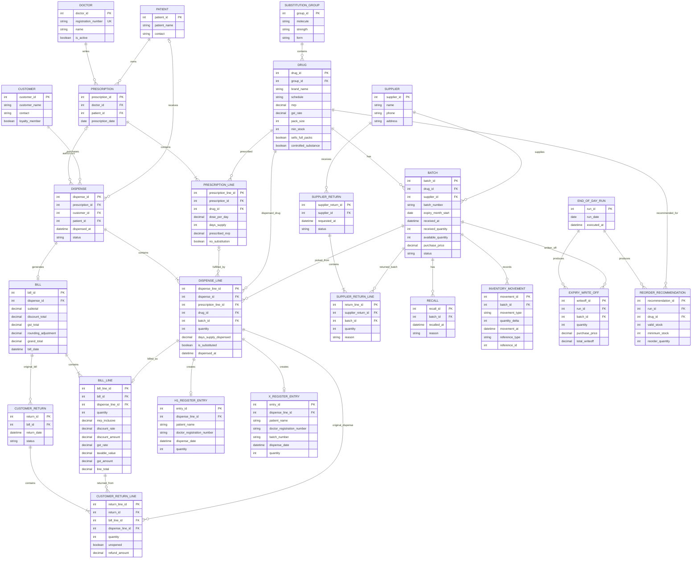

# PS-061 – Entity Relationship Diagram
## Pharmacy Inventory Management System

## Important Database Design Notes

1. Molecule, strength and form are maintained in the substitution group.
2. Each drug belongs to one substitution group.
3. Each drug can have multiple batches.
4. Each batch belongs to a supplier.
5. A prescription can contain multiple prescription lines.
6. A dispense line records the actual drug and batch dispensed.
7. Billing stores GST and discount calculations separately.
8. Customer returns link back to the original bill and dispense.
9. Schedule H1 and X register entries are maintained separately.
10. Inventory movements provide an audit trail of stock changes.
