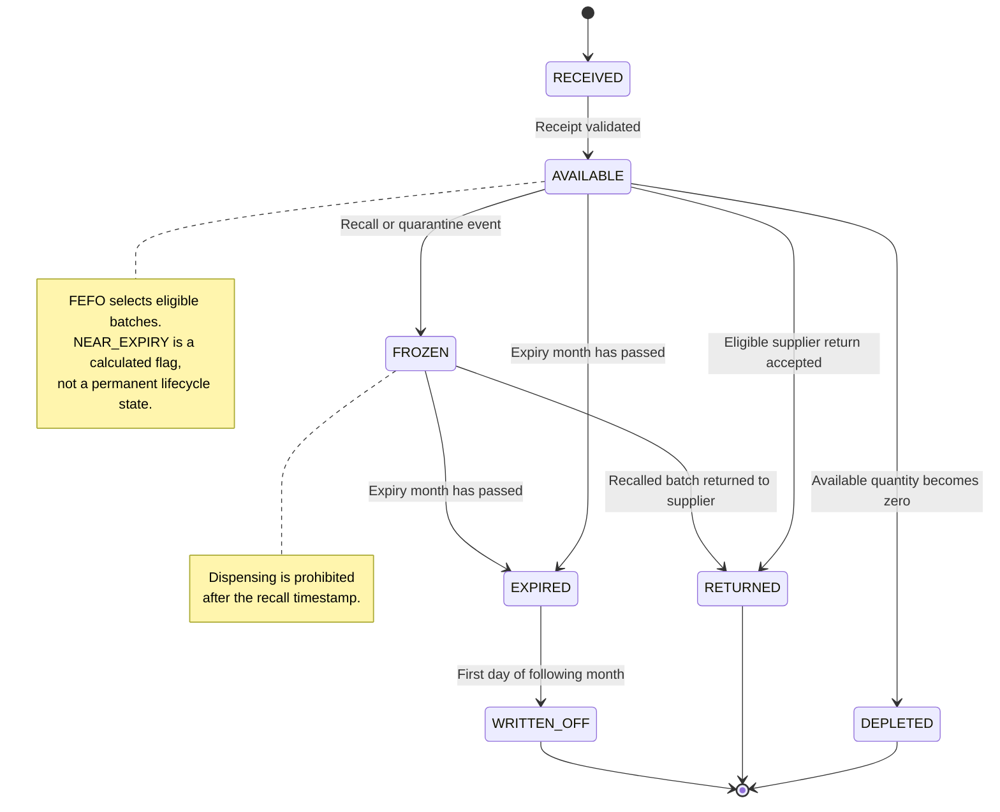
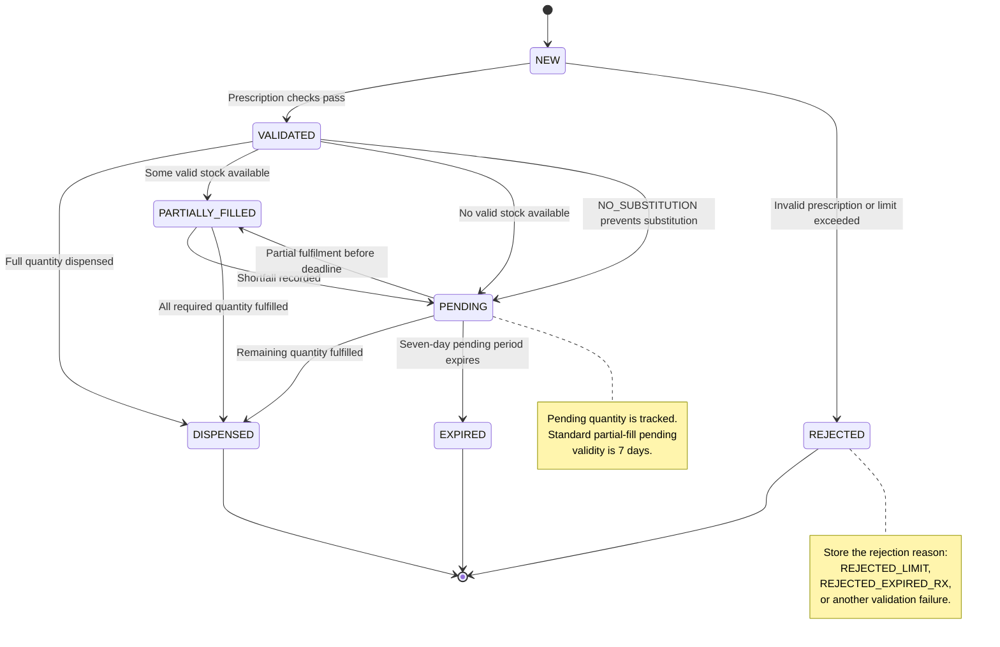

# PS-061 – State Diagrams

## 1. Batch Lifecycle State Diagram



## 2. Batch State Descriptions

| State | Description |
|---|---|
| RECEIVED | Stock batch has been received |
| AVAILABLE | Batch has usable stock |
| FROZEN | Batch cannot be dispensed |
| DEPLETED | Available stock is zero |
| RETURNED | Remaining stock has been returned to supplier |
| EXPIRED | Batch is past its expiry month |
| WRITTEN_OFF | Expired stock has been financially written off |

A batch is valid through the last calendar day
of its expiry month.

Expiry write-off occurs on the first day
of the following month.


## 3. Prescription Line State Diagram



## 4. Prescription State Descriptions

| State | Description |
|---|---|
| NEW | Prescription line is created |
| VALIDATED | Prescription and dispensing rules passed |
| PARTIALLY_FILLED | Some required units have been dispensed |
| PENDING | Outstanding quantity is awaiting fulfilment |
| DISPENSED | Entire required quantity has been dispensed |
| REJECTED | Dispensing is rejected |
| EXPIRED | Pending fulfilment period has ended |

## 5. Important Transition Rules

1. A prescription must pass validation before dispensing.
2. Partial dispensing occurs only when valid stock is insufficient.
3. The undispensed quantity is recorded as pending.
4. Pending partial-fill lines are valid for seven days.
5. A pending quantity fulfilled before its deadline completes the line.
6. A line with NO_SUBSTITUTION remains pending when the prescribed brand is unavailable.
7. Prescription validity, refill restrictions and rolling dispensing limits must be checked before every dispense.
```
