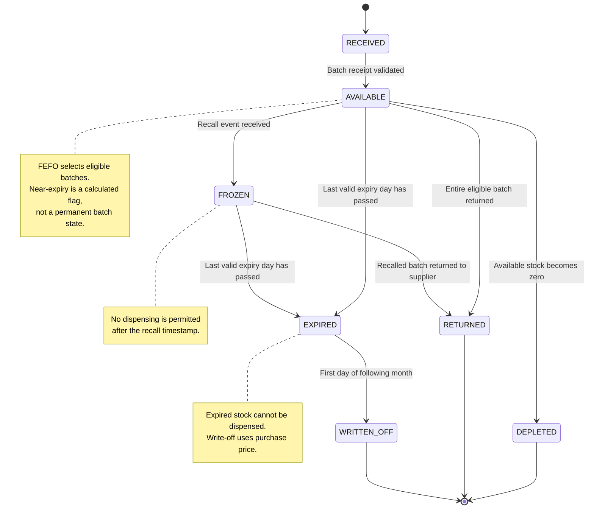
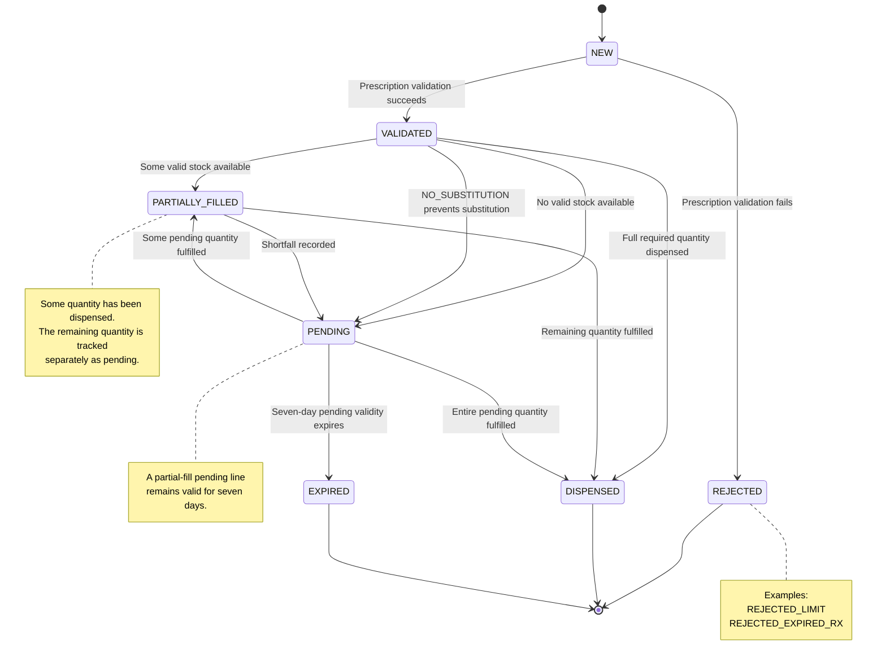

# PS-061 – Pharmacy Inventory Management System
# State Diagrams

## 1. Batch Lifecycle State Diagram

## 2. Batch State Descriptions

| State | Description |
|---|---|
| RECEIVED | Stock batch has been received |
| AVAILABLE | Batch contains usable stock |
| FROZEN | Batch is blocked due to recall |
| DEPLETED | Available stock becomes zero |
| RETURNED | Entire remaining eligible batch is returned |
| EXPIRED | Batch has passed its last valid expiry day |
| WRITTEN_OFF | Expired inventory has been financially written off |

Important rules:

- A batch remains valid through the last calendar day of its expiry month.
- Expiry write-off happens on the first day of the following month.
- Partial supplier returns are recorded as quantity movements; the batch need not enter RETURNED state until all remaining stock has been returned.
- A recall event must be recorded with its timestamp.
- Near-expiry status is calculated according to the business date.

---

## 3. Prescription Line State Diagram

## 4. Prescription Line State Descriptions

| State | Description |
|---|---|
| NEW | Prescription line has been created |
| VALIDATED | Prescription checks have passed |
| PARTIALLY_FILLED | Some required quantity has been dispensed |
| PENDING | Remaining quantity awaits fulfilment |
| DISPENSED | Entire required quantity has been dispensed |
| REJECTED | Dispensing request has been rejected |
| EXPIRED | Pending fulfilment validity has expired |

## 5. Important State Transition Rules

1. Prescription validation must occur before dispensing.
2. A prescription line may be rejected when validity, schedule or quantity restrictions fail.
3. Partial fill is permitted only when eligible stock is insufficient.
4. The dispensed quantity and remaining pending quantity must be stored separately.
5. A partial-fill pending line is valid for seven days.
6. Pending quantities may be fulfilled before the validity deadline.
7. Schedule X no-refill restrictions and Schedule H1 refill restrictions must be checked independently.
8. A NO_SUBSTITUTION line cannot be substituted when the prescribed brand is unavailable.

The specification does not separately define the pending validity period for NO_SUBSTITUTION lines. This remains an open design decision.
